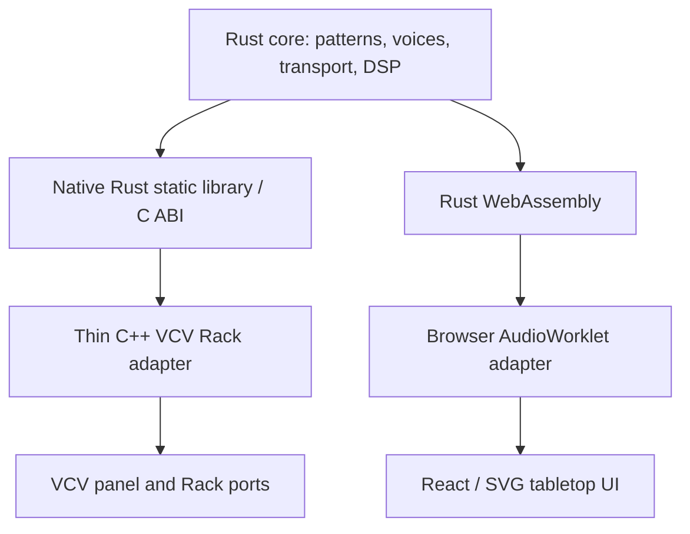

# Pocket Instruments — Research and Design Brief

**Status:** Working proposal, not an implementation specification  
**Version:** 0.1 · 18 November 2026  
**Owner / originator:** Kenny Inggs, with ChatGPT research and design collaboration  
**Purpose:** Portable reference for human and AI reviewers. All design choices are open to challenge unless marked *decided*.

## 1. Executive summary

Build a family of free, open-source, calculator-like musical instruments visibly and explicitly inspired by Teenage Engineering's Pocket Operators (POs). Each instrument should be fun, self-contained, immediately playable, and recognizable as an affectionate homage. Avoid TE branding and copying proprietary art, samples, and source code. Clearly identify the inspiration, disclaim affiliation, encourage users to buy the real hardware, and link directly to TE's official shop without affiliates.

Two hosts are planned:

1. **VCV Rack:** PO-shaped modules, with an extremely compact interface and approximately the original two-jack silhouette where feasible. More extensive Rack connections may live on an optional expander.
2. **Browser:** A playful virtual tabletop holding multiple little instruments, sharing a transport and eventually connecting together. This is intentionally *not* a duplicate of VCV's fully modular workflow.

Architecture hypothesis: a **shared, real-time-safe Rust musical engine** compiled natively for a thin C++ VCV Rack adapter and to WebAssembly for the browser. Reuse sequencer logic and, selectively, DSP. Keep host-specific controls, timing adapters, routing and UI native to each host. Favor MIT-family licensing where legally compatible.

**First milestone:** An actually useful, PO-shaped 16-key quantized pitch/CV instrument or minimal sequencer, running from the *same Rust core* in browser and VCV Rack. The first complete instrument should probably draw on the **PO-12 Rhythm**, which Kenny owns; he also owns a **PO-133** for direct comparison.

## 2. Decisions already made

| ID | Decision | State | Rationale |
|---|---|---|---|
| D1 | Near-replica form factor and UI philosophy | **Decided preference**, subject to IP review | The tiny calculator-like look, proportions, keypad and playful feel are essential |
| D2 | Prove one shared Rust engine early | **Decided** | Prevent discovery of fundamental cross-host issues after investing in sound/UI |
| D3 | Start with a simple sequencer/controller; later original synthesis | **Decided direction** | First useful milestone can be CV/gate; faithful workflow matters more than exact PO samples |
| D4 | Visually PO-like from the first prototype | **Decided** | Playfulness and tactile feel are part of the project, not a late skin |
| D5 | Shared DSP selectively, depending on instrument | **Decided** | Maximize useful code reuse without making every sound engine complicated |
| D6 | Browser is a *virtual tabletop*, not a modular rack | **Decided** | VCV already serves the deeper patch-cable modular use case |
| D7 | Explicit, positive credit to Teenage Engineering, genuine purchase links, no affiliate links | **Decided** | Open, transparent homage and genuine support for the originals |
| D8 | Free and permissively licensed, ideally MIT | **Decided goal**, legal due diligence pending | Easy reuse, forks, collaboration and education |
| D9 | Optional Rack expanders for deeper CV integration | **Preferred**, unresolved design | Preserve primary PO proportions and simplicity |
| D10 | Exact first instrument and initial top-jack roles | **Open** | Requires small usability prototypes and discussion |

## 3. Goals and non-goals

### Goals

- Preserve the PO interaction qualities: 16-step/16-key grid, immediate sound/control response, mode/button combinations, pattern chaining, parameter locks, performance effects and compelling feedback.
- Keep a family resemblance between instruments; make their individual personalities distinct.
- Produce useful musical modules at each milestone.
- Make multiple browser instruments play synchronously and interact musically.
- Offer Rack-native clock, reset, CV, gate, trigger and audio behavior where relevant.
- Publish clear educational explanations of sequencing, DSP and modulation.
- Enable other programmers and other AI systems to inspect, propose and contribute without needing proprietary dependencies.
- Keep instrument definitions, event semantics and saved patterns stable across hosts.

### Non-goals (initially)

- Emulating proprietary firmware, copying factory samples, importing TE graphical assets or claiming official endorsement.
- Making the browser a general-purpose VCV Rack clone.
- Supporting real PO hardware synchronization in the first prototype.
- Copying complete implementations from existing browser PO clones without reviewing each license and asset provenance.
- Achieving sample-perfect matching with PO hardware in the first release.
- Committing to a complex expander protocol before we know the main instrument's controls.

## 4. Research: relevant precedents

### PO-inspired browser implementations

| Project | Link | Relevance | Caveat |
|---|---|---|---|
| PO-12 browser emulator (`ulnd/po-12`) | https://github.com/ulnd/po-12 | Direct in-browser recreation; repository shows MIT license | Code license does not clear any third-party visual/audio IP |
| PO-20 simulator | https://github.com/franeklubi/pocket-operator-simulator | Sequencing and recognizable PO control behaviors | Verify license and all assets before reuse |
| PO-33 clone | https://github.com/jjbenson85/po-33 | Drum/melodic workflows | Verify license, quality and samples |
| Pocket-Operator-influenced music sequencer | https://github.com/padraigfl/music-sequencer | Deliberately adapts PO workflows for touch; 16-step/16-pattern model; Tone.js | License verification required |
| Seqbaby | https://github.com/mjoslyn/seqbaby | Multiple sound engines and sequencing in a browser | Not a PO-clone framework |
| Awesome TE directory | https://github.com/bnjreece/awesome-te | Index of simulators, sync utilities and reverse-engineering tools | Aggregator, not a grant of reuse rights |

### Explicit hardware ports in VCV Rack

| Project | Link | What it teaches |
|---|---|---|
| Audible Instruments / Mutable Instruments | https://github.com/VCVRack/AudibleInstruments | Recognizable ports that explicitly identify hardware models; existing source licenses matter |
| Befaco for VCV | https://github.com/VCVRack/Befaco | Strong focus on authentic behavior; README documents deliberate differences from hardware |
| Erica Synths VCV modules | https://library.vcvrack.com/EricaCopies | Familiar, explicitly hardware-derived modules are normal in the Rack ecosystem |
| VCV hardware clone category | https://library.vcvrack.com/?tag=Hardware+clone | Broad precedent; **does not** mean every homage is independently authorized |

**Important distinction:** Some ports involve brand-owner participation, open-source hardware firmware or permissions. Their existence does not confer permission to copy TE-specific designs. We should imitate the transparency, compatibility notes and faithful musical behavior, not presume their legal arrangements transfer to us.

### Rust, WebAssembly and Rack experiments

| Project | Link | Significance |
|---|---|---|
| Potential (Rust VCV plugin) | https://github.com/dbonel/potential | Evidence that a Rack plugin can bridge to Rust; build tooling is more involved |
| DanTCrusti | https://github.com/Miff-Real/DanTCrusti | C/Rust integration experiment for Rack |
| Birdsynth | https://github.com/davenull/birdsynth | Rust DSP compiled to WASM and run in an AudioWorklet |
| Glicol | https://github.com/chaosprint/glicol | Rust audio/DSP ecosystem with browser integration |
| Web Synth | https://hysenlabs.com/projects/ameobea-web-synth | Substantial Rust/WASM/browser audio and patching example |
| VCV plugin development | https://vcvrack.com/manual/PluginDevelopmentTutorial | Official C++ SDK starting point |
| Rack voltage standards | https://vcvrack.com/manual/VoltageStandards | Pitch, gate, reset and clock behaviors |

These establish **technical feasibility**, not a mature drop-in Rust Rack SDK. A working cross-host vertical slice is the first engineering gate.

## 5. Proposed technical architecture



### Ownership boundaries

- **Rust core** owns musical state, deterministic step progression, quantization, pattern operations, parameter locks, optionally synthesis, and serializable instrument state. It must never depend directly on React, browser APIs or Rack headers.
- **Rust FFI layer** exposes an explicitly versioned C-compatible API with opaque handles and simple POD buffers. No Rust panics unwind through C. The audio callback must not allocate or block.
- **VCV adapter** uses the official C++ SDK, produces/consumes CV and audio on its realtime thread, and implements the native Rack panel/widgets. UI-to-DSP communication must avoid unsafe cross-thread mutations.
- **Browser adapter** loads WASM in an AudioWorklet where timing/DSP requires it. The UI runs separately; a shared musical transport coordinates devices. Start with simple oscillator preview sounds for the first CV keyboard if no Rust DSP is needed yet.
- **Visual assets** are hand-authored and shared conceptually or as SVG sources; implementation details differ between Rack SVG/widgets and browser SVG/Canvas.

### Shared data shape, indicative only

```ts
type Step = {
  note: number | null;
  velocity: number;
  gate: number;
  probability: number;
  locks: Record<string, number>;
};

type Pattern = {
  version: 1;
  steps: Step[];
  length: number;
  seed: number;
};
```

Need to define whether `note` means MIDI semitone, scale degree, or a physical keypad index. Do **not** lock that in before deciding the keyboard model. Saved files should include an explicit schema version and migration plan.

### Timing and determinism

- Do not drive browser note timing from `setInterval` or React renders. Use Web Audio clock timestamps or worklet-owned event progression.
- Rack engine's `process()` is invoked per sample; translate clock transitions into events without allocating.
- Test note-on/note-off, reset, changing pattern length, swing, probability and parameter locks at multiple sample rates and buffer sizes.
- Define deterministic random seeds for probability, and test that a browser session and a Rack session produce the same *musical event trace*. Byte-for-byte audio equivalence is not mandatory for every instrument.
- Follow Rack's documented 1 V/oct convention and its reset/clock timing guidance (including ignoring near-simultaneous clock pulses immediately after reset where appropriate).

### Reuse expectations

- Very high: pattern model, quantization, step progression, parameter locks, deterministic event generation.
- High where chosen: oscillators, envelopes, effects, procedural drum synthesis.
- Low: audio host integration, physical patch handling, screen widgets, browser DOM.

**Engineering spike:** compile a tiny Rust state engine into WASM and a native library, then use the same test vector to drive a browser 4x4 keypad and a Rack plugin. Inspect compiler/linker workflows and realtime behavior on Arch/Omarchy Linux before extending the architecture.

## 6. First playable vertical slice: 'Pocket Keys' (temporary name)

### Proposed MVP

An original, calculator-shaped panel with a 4×4 set of numbered buttons, an animated numeric/graphic display, and simple musical output.

- Press a key: output a quantized 1 V/oct pitch and a held GATE.
- Release: gate falls; pitch may hold the last note.
- Optionally output a separate brief TRIG, useful for percussion.
- Select root/scale (initially chromatic + one or two scales).
- Simple step record and clocked 16-step playback could be phase 0.2 if the initial keypad alone feels too narrow.
- Browser version uses the exact same Rust note selection, but produces a simple audible preview tone rather than CV voltage.
- Both versions display active notes and share preset state.

**Unresolved:** How to assign two main top jacks (original PO metaphor versus useful Rack clock/CV), and where any gate/trigger connection lives. Do not assume a two-jack-only module can expose CLOCK IN, RESET IN, PITCH OUT and GATE OUT without a menu, mode switching or expander. Prototype at least two port layouts and test Rack ergonomics.

### Suggested acceptance tests

1. Same keypad sequence, root and scale produces identical note-event values in Rust native tests and WASM tests.
2. Rack panel buttons respond to pointer input; pitch voltage and gates can be patched into ordinary Rack oscillators/envelopes.
3. Browser panel buttons respond via mouse, touch and keyboard; preview audio plays after an audio-unlock gesture.
4. Held keys, fast alternation and release order are deterministic and documented (monophonic voice priority).
5. Save a pattern/preset in the browser and import the same semantic state into Rack (manual export/import acceptable initially).
6. No obvious per-sample heap allocations, panics crossing FFI or UI/audio data races.

## 7. First full instrument and future family

**Recommended first full homage: PO-12 Rhythm.** Kenny has the actual hardware to test workflows. Compared with a PO-133/PO-33 sampling instrument, it sidesteps the first-order complexity of live recording, sample management, storage, waveform slicing and potential proprietary factory-sample rights. Behavioral reference: the open-source browser PO-12 emulator, after source and asset licensing checks.

Potential progression:

1. **0.1** Cross-host Rust keypad, quantized notes/gates, PO-like interface.
2. **0.2** Step record, replay, clock/reset and simple pattern save.
3. **0.3** Browser tabletop with 2–3 instruments and a shared musical transport; avoid overbuilding patch cables.
4. **0.4** Full drum/rhythm instrument inspired by PO-12, with *original* generated drum voices, pattern locks and performance effects.
5. **0.5** Rack expander experiments, individual drum trigger/audio and parameter CV.
6. **Later** A sampling instrument informed by Kenny's PO-133, imported user samples and clearly original artwork.

## 8. Rack panel, jacks and expanders

**Desired design:** preserve the physical PO's little calculator-like silhouette, compact control locations and two top ports as much as is safe and usable. The Rack panel's proportions and width must be tested against Rack's HP/grid constraints rather than inferred from the physical object. Exact TE character artwork, logos and proprietary graphical assets should not be carried over.

**Possible strategies, not yet chosen:**

- **Dual-purpose ports:** assign common functions to the two top jacks, change assignments by mode/context menu. Excellent silhouette, potentially confusing to patch.
- **Core + expander:** keep two visible jacks on the core, put CLOCK/RESET/PITCH/GATE and later voice CV/audio on an optional adjacent module. Better visual fidelity; more UI/expander complexity.
- **Discrete hidden/secondary ports:** retain top two but integrate additional Rack jacks subtly; potentially weakens authenticity.

Expander should not become a mandatory dependency just to use the main instrument. Prioritize a self-contained instrument. In VCV, an adjacency/expander message interface is distinct from patch-cable CV I/O; design both deliberately. Document every Rack adaptation versus physical hardware, following the Befaco project's precedent.

## 9. Browser tabletop

The browser is not intended to reproduce Rack. It is a virtual desk with little instruments placed next to one another, each with its own physical-looking controls and display. Basic shared transport, sync, volume and eventually device-to-device interactions should feel like chaining physical POs.

First UI could use React + Vite + TypeScript; SVG for panel/buttons and Canvas/SVG for animated displays. Use Web Audio and AudioWorklets when required. Browser MIDI and hardware sync are later optional features. Keep a single audio context/master clock to prevent drift between devices.

Avoid inventing a full modular routing language at v0.1. Define a small conceptual interface: instrument clock input, note/trigger events, audio output and a limited set of modulation parameters. Expand later if it earns its complexity.

## 10. IP, attribution, and licensing strategy

**This is project planning, not a legal opinion.** An explicit homage and favorable promotion do not grant the right to copy a protected visual design. Patent, copyright, trademark and trade-dress questions are distinct and jurisdiction-dependent; an international public release deserves an IP review.

Working safeguards:

- No TE logo, official product trade dress claims, or product name presented as ours.
- Describe instruments as *independent, unofficial homages inspired by* named PO products.
- Create all graphical assets and animations ourselves; don't extract TE bitmap/LCD art or official sample content.
- Link directly to official TE products, without affiliate tracking, but do not use official product photography without checking permission.
- Explain what is faithful to the original and what differs; add a per-instrument 'Inspiration and Differences' page.
- Distinguish behavioral study from code reuse: third-party MIT code still may contain assets or materials with different rights.
- Before public release, review actual front-panel mockups for overall visual similarity, relevant design patents, trade dress and regional risks. Consider approaching TE for specific permission/support once there is a concrete mockup.

**Suggested attribution text:**

> This independent, open-source instrument is inspired by Teenage Engineering's Pocket Operator series. We love the original hardware and encourage you to experience it. If you enjoy this project, please consider buying a genuine Pocket Operator from Teenage Engineering. This project is not affiliated with, endorsed by, or sponsored by Teenage Engineering.

Official links: https://teenage.engineering/products/po and https://teenage.engineering/store/pocket-operators

**Licensing plan:** MIT for original Rust core, browser code, Rack adapter and original artwork where practical; retain explicit per-dependency license notices. Rack's current non-commercial plugin exception explicitly permits free-of-charge plugins under MIT or other non-GPL terms provided the plugin obeys the exception; copying non-API GPL Rack implementation code can change obligations. Commercial distribution would require separate review. Source: https://vcvrack.com/manual/PluginLicensing and https://github.com/VCVRack/Rack/blob/v2/LICENSE.md

Additional source on TE's materials policy: https://teenage.engineering/ip-rights-te-products and https://teenage.engineering/terms-of-service

## 11. Risks and validation experiments

| Risk | Severity | Early experiment / mitigation |
|---|---|---|
| Rust native static library + C++ Rack toolchain friction | High | Smallest cross-host keypad engine in week 1 |
| Real-time safety across FFI and WASM | High | Fixed buffers; no allocations in processing; continuous/sustained test |
| Visual PO similarity beyond safe homage | High | Original asset provenance; legal mockup review; optional TE outreach |
| Two-top-jack silhouette conflicts with useful Rack CV | Medium | Prototype 2–3 port layouts; real patching usability test |
| Browser audio timing drift between instances | Medium | Single AudioContext/worklet-based transport and event trace tests |
| Cross-host event semantics diverge | Medium | Shared deterministic test fixtures at multiple tempos/sample rates |
| Overbuilding framework before one fun instrument | High | Require playable acceptance criteria at each milestone |
| Unchecked license or proprietary samples in reference clones | Medium | Treat repos as reference until audited |

## 12. Open decisions / next interview

1. **First user interaction:** Chromatic keypad with root selection, scale-degree keypad, or a PO-style step-entry controller? How do note-off and multi-press behave?
2. **First module output ports:** Which two top jacks are visible/functional? Is GATE indispensable on the base module? What is the minimum expander interface?
3. **First milestone scope:** Just keyboard CV/gate, or immediate 16-step capture/clock playback as part of the same deliverable?
4. **Visual fidelity boundary:** Which hardware details are essential (calculator silhouette, circular keys, LCD placement, knobs), and which can be original?
5. **Browser interaction:** Desktop mouse/keyboard first versus phone/touch from day one?
6. **Project identity:** A distinctive original family name; per-instrument naming inspired by (not identical to) the PO models.
7. **TE outreach:** Before code, once a visual prototype exists, or just before public release?
8. **Contribution model:** GitHub MIT with design RFCs and architecture decision records; decide whether outside AI-generated contributions require provenance declarations.

## 13. Independent AI review brief (copy into Claude or another system)

> You are reviewing a proposed open-source musical instrument project. Read the attached *Pocket Instruments — Research and Design Brief* fully. Treat existing choices as strong preferences but challenge them where useful. We want recognizable, explicitly attributed Teenage Engineering Pocket Operator-inspired calculator-like instruments, released free with MIT-like licensing, playable both as VCV Rack modules and a browser tabletop. Our leading architecture is a shared Rust engine compiled to native code behind the VCV C++ API and WASM inside a browser AudioWorklet. We own a PO-12 Rhythm and PO-133 for behavioral comparison. The first milestone is a PO-shaped 16-button quantized pitch/CV or minimal step sequencer, genuinely useful in both environments.
>
> Please deliver a critical design review, not just encouragement. Specifically:
>
> 1. Challenge whether Rust sharing at the engine/DSP level is worth the toolchain and FFI cost. Compare a pure-C++ core compiled to WASM, Rust with C++ wrapper, and separate TypeScript/C++ implementations. Identify a practical proof-of-concept benchmark for each.
> 2. Find real source-code precedents for Rust Rack plugins, Rust WASM AudioWorklets, PO emulators, and recognizable hardware-inspired Rack panels. Verify actual licenses and point out any assumptions that the brief gets wrong.
> 3. Evaluate realistic IP/trademark/design-patent/trade-dress risks for a close PO visual homage, including design modifications that preserve the essential feel. Distinguish legal requirements from risk-reduction recommendations. Do not provide false certainty.
> 4. Propose 2–3 alternative first MVPs, including the exact VCV ports and interaction semantics, and rank them by musical usefulness and architectural learning.
> 5. Design a credible native/WASM shared engine interface with deterministic events, transport semantics, real-time safety, state serialization, and tests. Highlight what must remain host-specific.
> 6. Propose how a two-jack primary PO-shaped panel and an optional Rack expander could work, including common Rack usability pitfalls.
> 7. Identify three creative extensions beyond the original hardware that fit the educational/playful design philosophy.
> 8. Give your top ten technical/product risks, hard unknowns, and experiments that would falsify the current plan.
>
> Respond with: **Executive recommendation; What I'd change; Verified references; Proposed architecture; Minimal vertical slice; IP/attribution review; Open decisions.** Cite primary sources for factual/legal/technical claims. Mark unverified assertions clearly. Do not write implementation code yet.

## 14. Research source index

Primary official documentation and repositories consulted during research:

- VCV plugin licensing: https://vcvrack.com/manual/PluginLicensing
- VCV Rack source license: https://github.com/VCVRack/Rack/blob/v2/LICENSE.md
- Rack plugin development tutorial: https://vcvrack.com/manual/PluginDevelopmentTutorial
- Rack voltage standards: https://vcvrack.com/manual/VoltageStandards
- Rack official hardware clone listings: https://library.vcvrack.com/?tag=Hardware+clone
- Audible Instruments: https://github.com/VCVRack/AudibleInstruments
- Befaco VCV: https://github.com/VCVRack/Befaco
- PO-12 browser emulator: https://github.com/ulnd/po-12
- PO-inspired browser sequencer: https://github.com/padraigfl/music-sequencer
- Rust Rack plugin report: https://community.vcvrack.com/t/adventures-in-plugin-development-in-rust/19979
- Rust Rack community thread: https://community.vcvrack.com/t/using-rust-for-vcv-rack-modules/25294
- Rust WASM synthesizer: https://github.com/davenull/birdsynth
- Web Audio AudioWorklets: https://developer.mozilla.org/en-US/docs/Web/API/AudioWorklet
- Tone.js: https://github.com/Tonejs/Tone.js
- TE PO product page: https://teenage.engineering/products/po
- TE official PO store: https://teenage.engineering/store/pocket-operators
- TE protected material policy: https://teenage.engineering/ip-rights-te-products

### Research limitations

This is a curated discovery/design brief, not a complete source-code audit, patent clearance search or reproduced-hardware technical specification. Repository maintenance, licenses and web content can change. References should be reopened before taking code or making a public release. The comparative reuse estimates are engineering judgments, not measurements. An independent AI review should explicitly attempt to falsify this plan.
